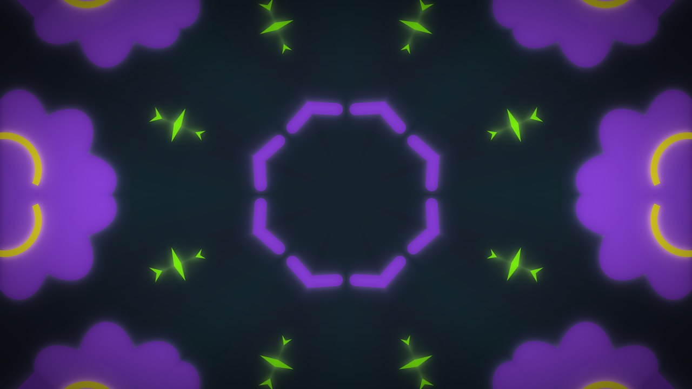
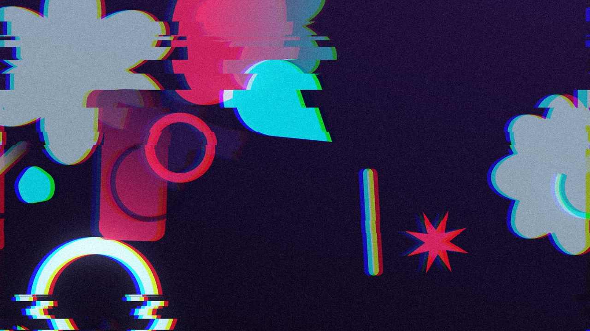
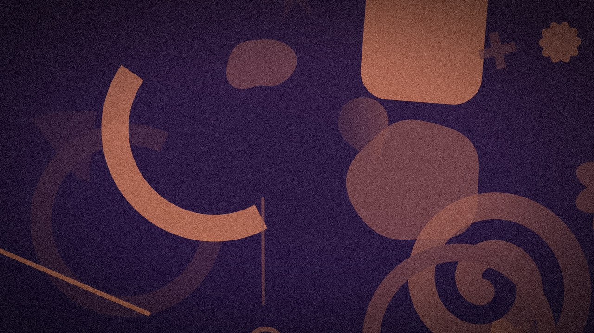
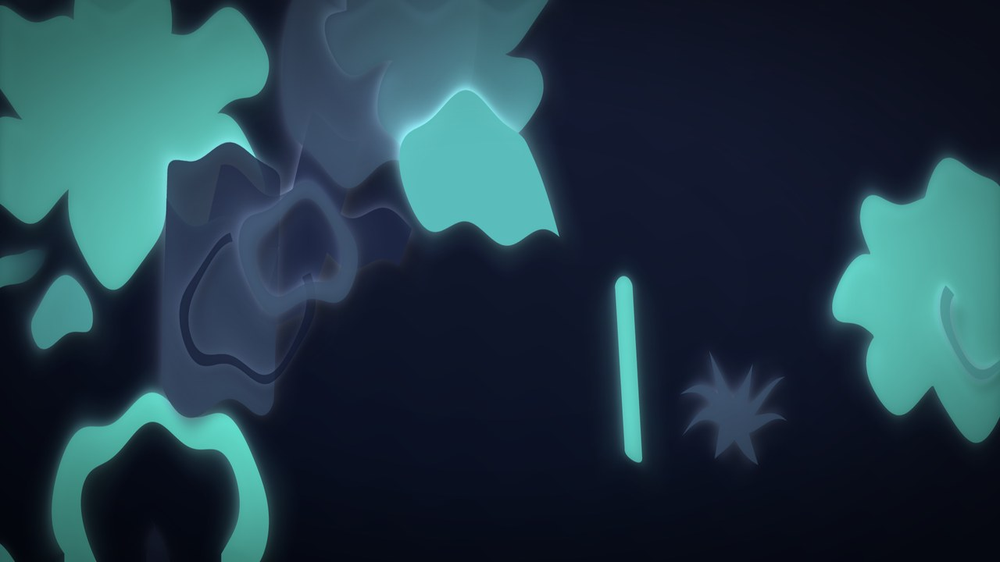
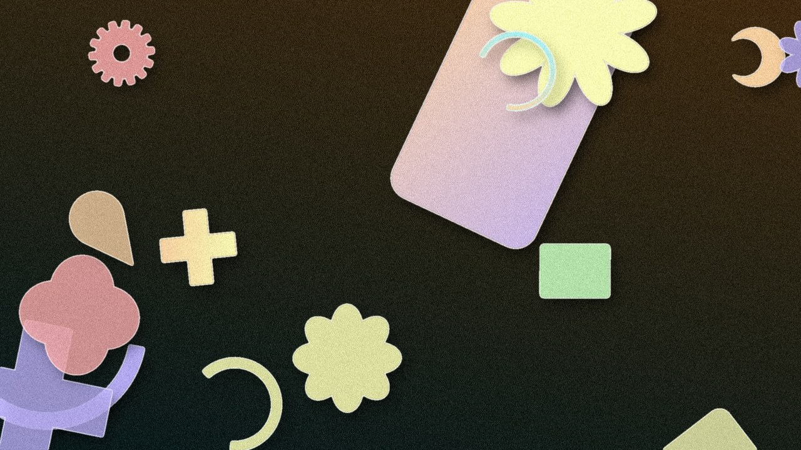
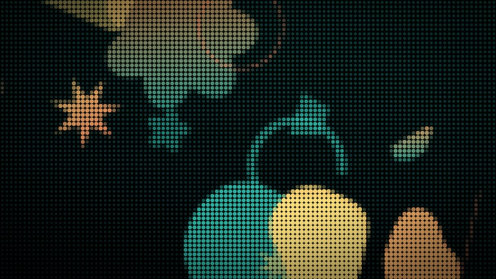
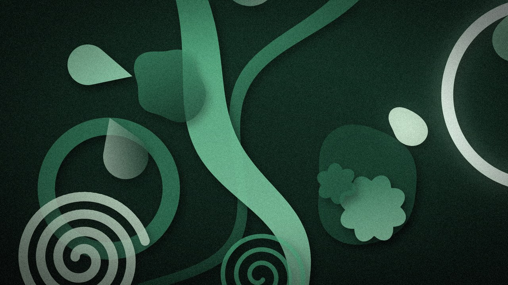

# Picture Random Generator (PRG)

Генератор абстрактных изображений на чистых алгоритмах (Pillow + NumPy), без ИИ.

## Примеры
Все картинки сгенерированы проектом без ИИ и ручной доработки (здесь уменьшены до 1280×720). Разные палитры, формы и эффекты.

| | |
|---|---|
|  |  |
| `neon` · `kaleidoscope, glow, vignette` | `cyberpunk` · `glitch, aberration, bloom, grain` |
|  |  |
| `sunset` · `duotone, vignette, grain` | `ocean` · `light_rays, bloom, vignette` |
|  |  |
| `aurora` · `ripple, glow, shadow, vignette` | `pastel` · фигуры gear, cross, rounded_rect… · `shadow, outline, grain` |
|  |  |
| `retro` · `halftone, vignette` | `forest` · фигуры flower, drop, spiral… · `bloom, shadow, vignette, grain` |

## Возможности
- Формы: круг, кольцо, многоугольник, звезда, линия, блоб, волна — с антиалиасингом, градиентной заливкой и прозрачностью.
- Эффекты: тень, свечение, контур (поэлементные); bloom, лучи света, размытие, зерно, виньетка, жидкое искажение, рябь, сдвиг оттенка, хроматическая аберрация, глитч, калейдоскоп, полутон, дуотон.
- Палитры: 12 именованных или генерация от доминирующего цвета/оттенка (схемы analogous, complementary, triadic, split, mono).
- Любой размер холста: пресеты, `WxH`, `random`; результат не зависит от разрешения.
- Пакетная генерация в несколько процессов, воспроизводимость по seed.
- Плагины: новая форма или эффект — один файл.
- GUI (Tkinter) и автосмена обоев на нескольких мониторах (Windows).

## Автосмена обоев (Windows, несколько мониторов)
Картинка генерируется под точное разрешение каждого монитора и ставится через `IDesktopWallpaper`.

Проще всего — блок «Обои рабочего стола» в окне программы: интервал смены, запуск при входе в Windows и галочка
**«Минимальный приоритет»**. Она включена по умолчанию: смена идёт в фоновом режиме Windows и не нагружает компьютер —
это удобно, когда свободной памяти мало. Без галочки смена проходит в несколько раз быстрее.

Из консоли (для exe вместо `python wallpaper.py` пишите `PRG.exe wallpaper`):
```
python wallpaper.py start|stop|status      # фоновый процесс (без окна)
python wallpaper.py once                   # сменить один раз
python wallpaper.py autostart on|off       # ярлык в папке «Автозагрузка»
```
Настройки — `wallpaper.json` (интервал, палитра, цвет, эффекты, приоритет…), лог — `wallpaper.log`,
картинки — `wallpapers/` (хранятся последние циклы). В exe настройки и лог лежат в `%LOCALAPPDATA%\PRG`,
обои — в `Изображения\PRG\wallpapers`.

> **Если Windows подвисает на несколько секунд при смене обоев** — это не генератор, а сама система:
> включён автоматический выбор акцентного цвета по фону, и Windows пересчитывает цвет оформления
> при каждой смене обоев. Отключите его: **Параметры → Персонализация → Цвета → «Выбор главного цвета»**
> — поставьте «Ручной» (или снимите «Автоматический выбор главного цвета фона»). После этого смена обоев проходит без лагов.

## Готовый exe (Windows)
1. Скачайте `PRG.exe` из [Releases](https://github.com/XanterProject/abstract-art-generator/releases/latest).
2. Запустите двойным щелчком — откроется окно программы. Python устанавливать не нужно.

Готовые картинки сохраняются в папку `Изображения\PRG`.

Хотите собрать exe сами? Выполните `powershell -File build_exe.ps1` — файл появится в `dist\PRG.exe`.

## Установка (из исходников)
```
python -m venv .venv
.venv\Scripts\pip install -r requirements.txt
```

## Использование
```
python main.py --list                                   # палитры, формы, эффекты, размеры
python main.py --count 8 --size fhd --palette neon --effects "glow,shadow,grain" --out out
python main.py --count 4 --size 1500x900 --color "#3366ff" --scheme complementary
python main.py --count 10 --size random --variations --hue 30
python gui.py                                           # графический интерфейс
```

| Параметр | Описание |
|---|---|
| `--size` | пресет (`hd fhd qhd 4k square a4 phone banner ...`), `WxH` или `random` |
| `--palette` | именованная палитра или `random` |
| `--color` / `--hue` | доминирующий цвет `#rrggbb` / оттенок 0..360; `--scheme analogous\|complementary\|triadic\|split\|mono`, `--dominance 0..1` |
| `--bg` | `auto\|dark\|light` |
| `--shapes`, `--shape-types` | число фигур (`N` или `MIN-MAX`), список форм |
| `--effects` | `имя:параметр=значение:параметр=значение,имя2,...` (см. `--list`) |
| `--variations` | случайный поднабор эффектов для каждой картинки |
| `--seed`, `--count`, `--workers`, `--format`, `--out` | воспроизводимость и батч |

Каждая картинка пишется вместе с `.json` (seed, палитра, эффекты). Изображение `i` использует `seed+i`, поэтому
`--seed <seed_i> --count 1` воссоздаёт любую картинку. Размеры эффектов задаются относительно холста
(`min(W,H)/1000`), поэтому вид не зависит от разрешения.

## Свой плагин
Файл в `effects/` (или `shapes/`) — и он сразу доступен в CLI и GUI:
```python
from registry import register_effect, SCOPE_GLOBAL

@register_effect("invert", SCOPE_GLOBAL)
def invert(img, rng, unit, amount=1.0):
    ...
    return img
```

## Тесты
```
.venv\Scripts\python -m pytest
```

## Лицензия
MIT — см. [LICENSE](LICENSE).
