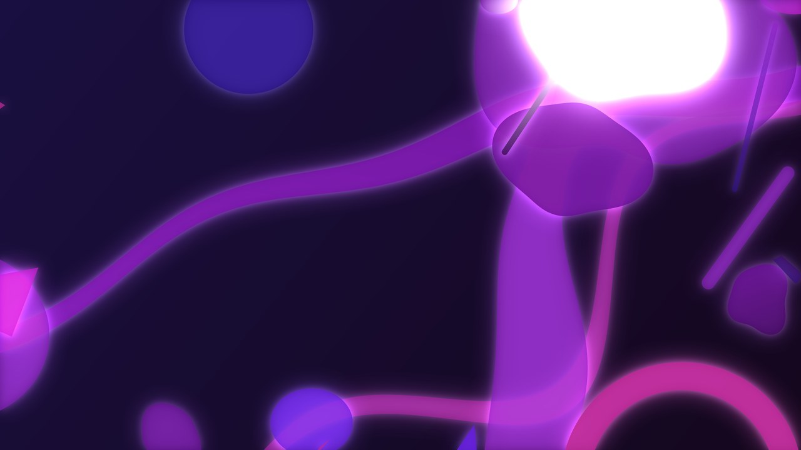
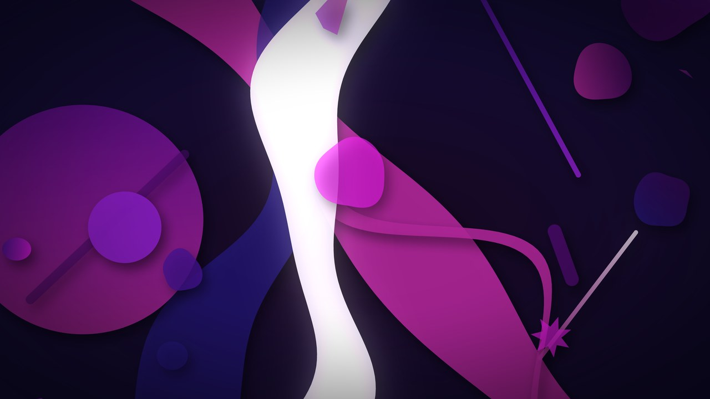
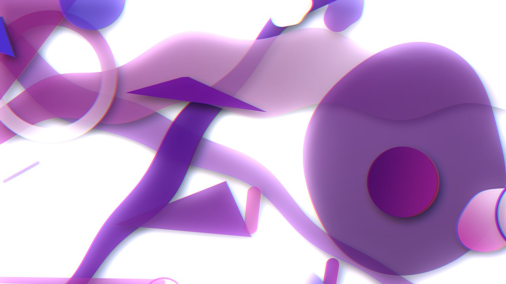

# Picture Random Generator (PRG)

Генератор абстрактных изображений на чистых алгоритмах (Pillow + NumPy), без ИИ.

## Примеры
Все картинки сгенерированы проектом (палитра строится от одного доминирующего цвета, 3840×2160, здесь уменьшены).

| |
|---|
|  
| `bloom, glow` 
|  
| `bloom, shadow, vignette` 
| 
| `aberration, bloom, shadow`

## Возможности
- Формы: круг, кольцо, многоугольник, звезда, линия, блоб, волна — с антиалиасингом, градиентной заливкой и прозрачностью.
- Эффекты: тень, свечение, контур (поэлементные); bloom, лучи света, размытие, зерно, виньетка, жидкое искажение, рябь, сдвиг оттенка, хроматическая аберрация, глитч, калейдоскоп, полутон, дуотон.
- Палитры: 12 именованных или генерация от доминирующего цвета/оттенка (схемы analogous, complementary, triadic, split, mono).
- Любой размер холста: пресеты, `WxH`, `random`; результат не зависит от разрешения.
- Пакетная генерация в несколько процессов, воспроизводимость по seed.
- Плагины: новая форма или эффект — один файл.
- GUI (Tkinter) и автосмена обоев на нескольких мониторах (Windows).

## Готовый exe (Windows)
Скачайте `PRG.exe` из [Releases](https://github.com/XanterProject/abstract-art-generator/releases/latest) — Python не нужен.
Двойной щелчок открывает GUI. Результаты по умолчанию — в `Изображения\PRG`, обои для автосмены — в `Изображения\PRG\wallpapers`,
настройки и лог — в `%LOCALAPPDATA%\PRG`. Фоновая смена обоев: `PRG.exe wallpaper start|stop|once|status|autostart on|off`.
Галочка «Минимальный приоритет» (по умолчанию включена) запускает смену обоев в фоновом режиме Windows — для случая, когда свободной памяти мало; без неё смена идёт в несколько раз быстрее (приоритет BELOW_NORMAL).
Собрать самому: `powershell -File build_exe.ps1` (результат — `dist\PRG.exe`).

## Установка (из исходников)
```
python -m venv .venv
.venv\Scripts\pip install -r requirements.txt
```

## Использование
```
python main.py --list                                   # палитры, формы, эффекты, размеры
python main.py --count 8 --size fhd --palette neon --effects "glow,shadow,grain" --out out
python main.py --count 4 --size 1500x900 --color "#3366ff" --scheme complementary
python main.py --count 10 --size random --variations --hue 30
python gui.py                                           # графический интерфейс
```

| Параметр | Описание |
|---|---|
| `--size` | пресет (`hd fhd qhd 4k square a4 phone banner ...`), `WxH` или `random` |
| `--palette` | именованная палитра или `random` |
| `--color` / `--hue` | доминирующий цвет `#rrggbb` / оттенок 0..360; `--scheme analogous\|complementary\|triadic\|split\|mono`, `--dominance 0..1` |
| `--bg` | `auto\|dark\|light` |
| `--shapes`, `--shape-types` | число фигур (`N` или `MIN-MAX`), список форм |
| `--effects` | `имя:параметр=значение:параметр=значение,имя2,...` (см. `--list`) |
| `--variations` | случайный поднабор эффектов для каждой картинки |
| `--seed`, `--count`, `--workers`, `--format`, `--out` | воспроизводимость и батч |

Каждая картинка пишется вместе с `.json` (seed, палитра, эффекты). Изображение `i` использует `seed+i`, поэтому
`--seed <seed_i> --count 1` воссоздаёт любую картинку. Размеры эффектов задаются относительно холста
(`min(W,H)/1000`), поэтому вид не зависит от разрешения.

## Свой плагин
Файл в `effects/` (или `shapes/`) — и он сразу доступен в CLI и GUI:
```python
from registry import register_effect, SCOPE_GLOBAL

@register_effect("invert", SCOPE_GLOBAL)
def invert(img, rng, unit, amount=1.0):
    ...
    return img
```

## Автосмена обоев (Windows, несколько мониторов)
Картинка генерируется под точное разрешение каждого монитора и ставится через `IDesktopWallpaper`.
Проще всего — блок «Обои рабочего стола» в `gui.py`. Из консоли:
```
python wallpaper.py start|stop|status      # фоновый процесс (без окна)
python wallpaper.py once                   # сменить один раз
python wallpaper.py autostart on|off       # ярлык в папке «Автозагрузка»
```
Настройки — `wallpaper.json` (интервал, палитра, цвет, эффекты…), лог — `wallpaper.log`,
картинки — `wallpapers/` (хранятся последние циклы).

> **Если Windows подвисает на несколько секунд при смене обоев** — это не генератор, а сама система:
> включён автоматический выбор акцентного цвета по фону, и Windows пересчитывает цвет оформления
> при каждой смене обоев. Отключите его: **Параметры → Персонализация → Цвета → «Выбор главного цвета»**
> — поставьте «Ручной» (или снимите «Автоматический выбор главного цвета фона»). После этого смена обоев проходит без лагов.

## Тесты
```
.venv\Scripts\python -m pytest
```

## Лицензия
MIT — см. [LICENSE](LICENSE).
